# Foundations of Differential Drive Kinematics & Feedback Control

This module explores the foundational mechanics of differential-drive robots using the `e-puck` platform in Webots. It progresses from open-loop velocity commands to closed-loop Proportional (P) position control.

##  Objectives
1. **Open-Loop Actuation:** Analyze how asymmetric, time-varying wheel velocities warp the robot's spatial trajectories.
2. **Sensor Feedback Alignment:** Utilize Compass sensor telemetry to execute rapid, dead-reckoned angular steering with minimal steady-state error.
3. **Inverse Kinematics Derivation:** Mathematically transform target linear ($v$) and angular ($\omega$) velocities into exact left/right motor angular speeds.
4. **Proportional (P) Position Control:** Implement a closed-loop controller to navigate the robot to a global coordinate $(0,0)$ from 10 distinct, radial starting configurations.

---

##  Mathematical Modeling (Inverse Kinematics)

Given an axle track width $L$ and wheel radius $r$, the controller converts target spatial velocities to motor commands using:

$$\dot{\phi}_L = \frac{2v - \omega L}{2r}$$

$$\dot{\phi}_R = \frac{2v + \omega L}{2r}$$

---

##  Experimental Results

### 1. Kinematic Trajectory Profiling (Q1 & Q3)
Below are the mapped trajectories comparing open-loop velocity configurations:
* **Asymmetric Static Rates:** $\phi_1 = 1 \text{ rad/s}, \phi_2 = -1 \text{ rad/s}$ results in pure on-the-spot rotation.
* **Harmonic Input:** $\phi_1 = \cos(2t)$, $\phi_2 = \sin(-t)$ creates a beautiful, repetitive Lissajous-like spatial pattern.

### 1. Open-Loop Actuation (Q1)
| Circular Path | Spiral Pattern |
| :---: | :---: |
| 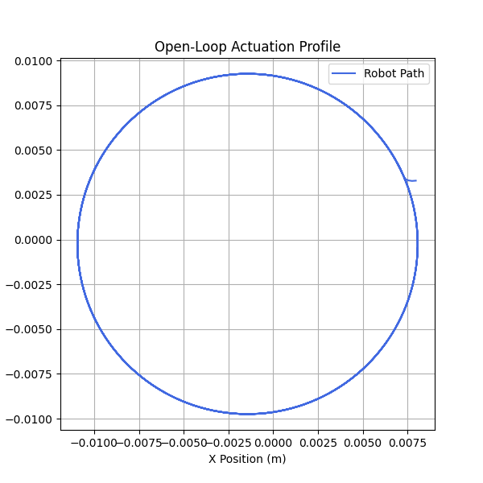 | 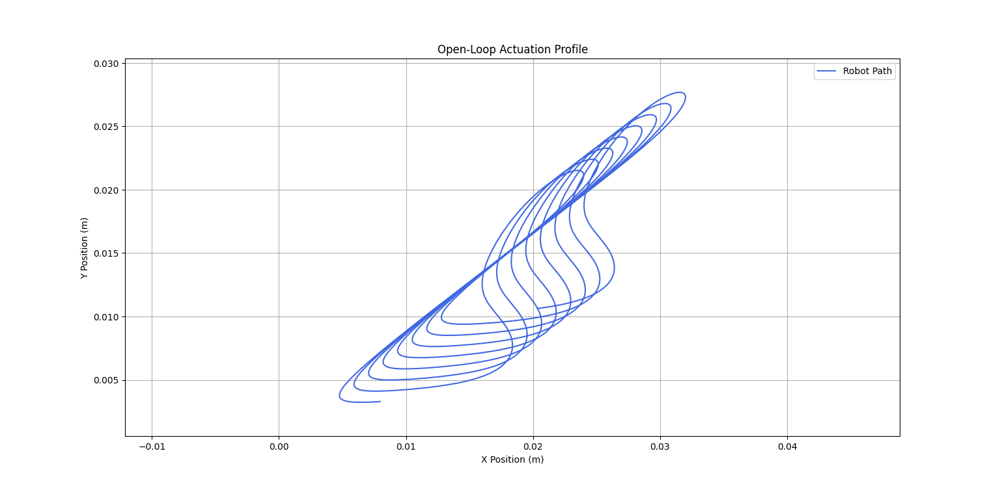 |

### 3. Inverse Kinematics Validation (Q3)
| Velocity V=0.01, ω=-0.3 | Velocity V=0.04, ω=0.2 |
| :---: | :---: |
| 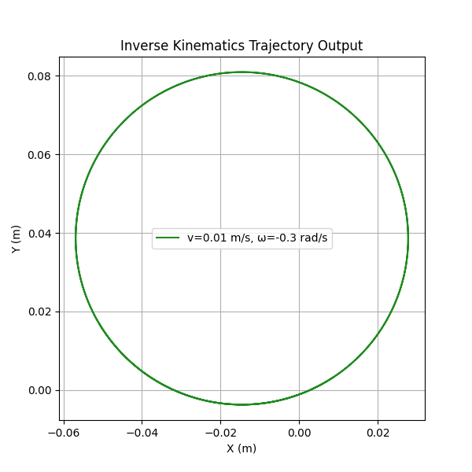 | 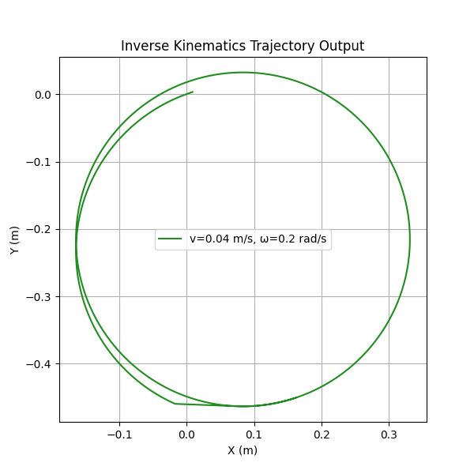 |

### 2. Angular Heading Controller (Q2)
Using a compass sensor, the controller computes heading error:

$$\theta_{\text{error}} = \theta_{\text{target}} - \theta_{\text{current}}$$

The robot successfully aligns with target angles in minimal time with zero overshoot using fine-tuned gains.

### 3. Radial P-Controller Convergence (Q4)
To validate the Proportional Position Controller, the robot was spawned at 10 equidistant coordinates on a circle of radius $0.5\text{ m}$ centered at $(0,0)$. 

The plot below shows all 10 paths smoothly converging to the origin $(0,0)$, demonstrating the stability of our feedback loop:

| | |
| :---: | :---: |
| 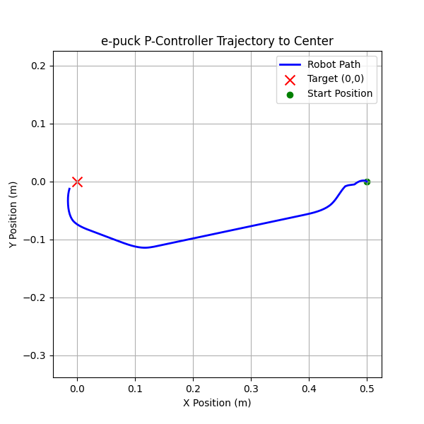 | 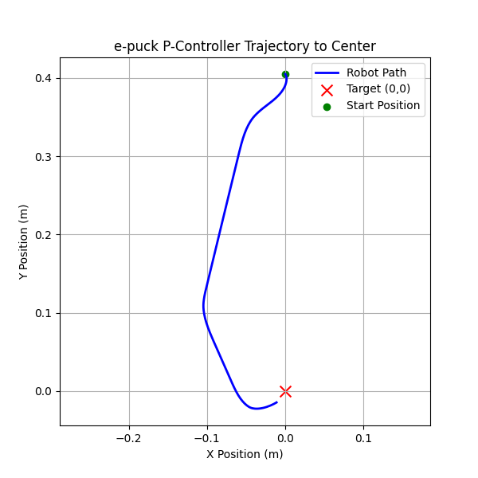 |
| 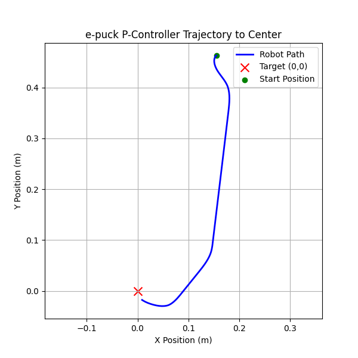 | 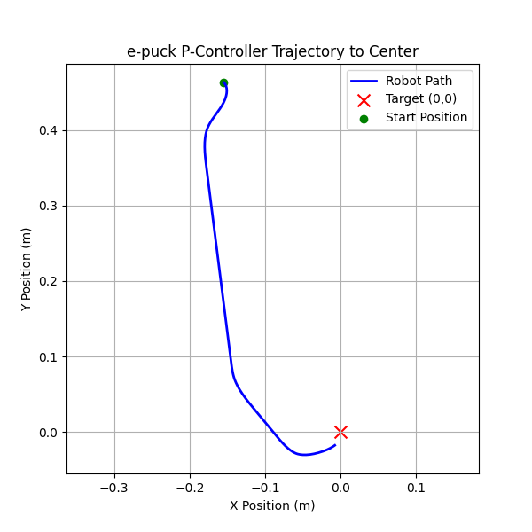 |
| 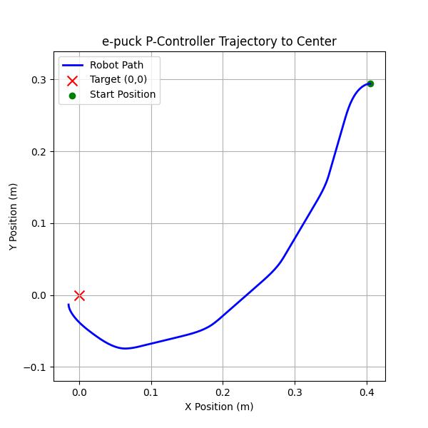 | 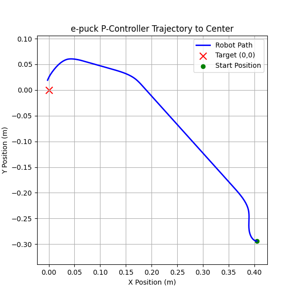 |
| 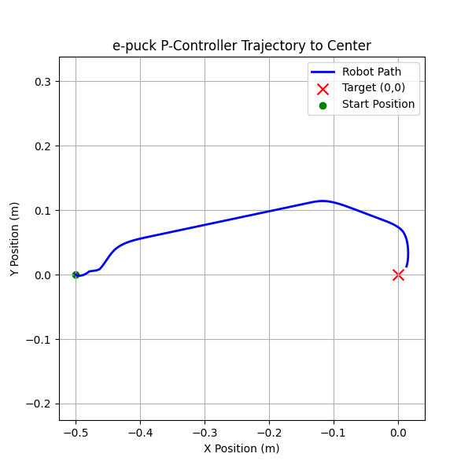 | 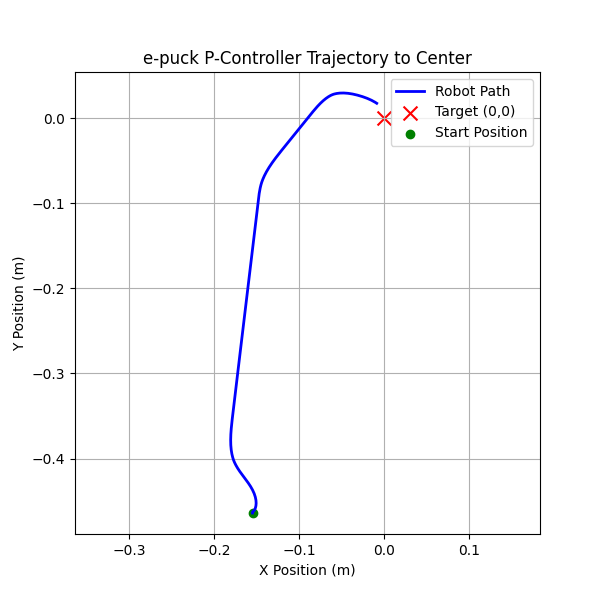 |
