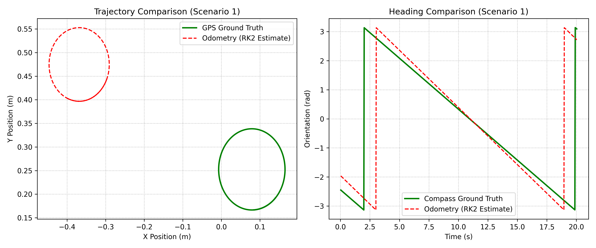
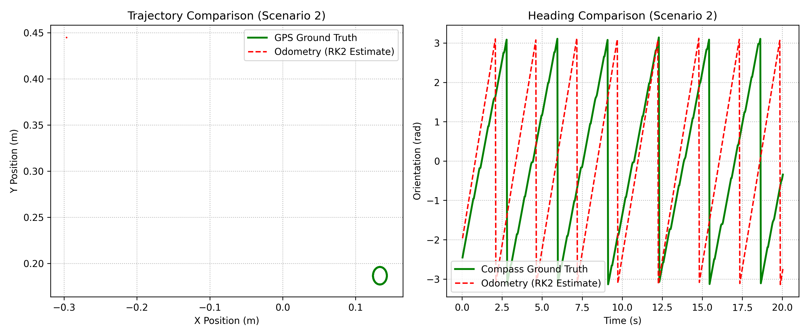
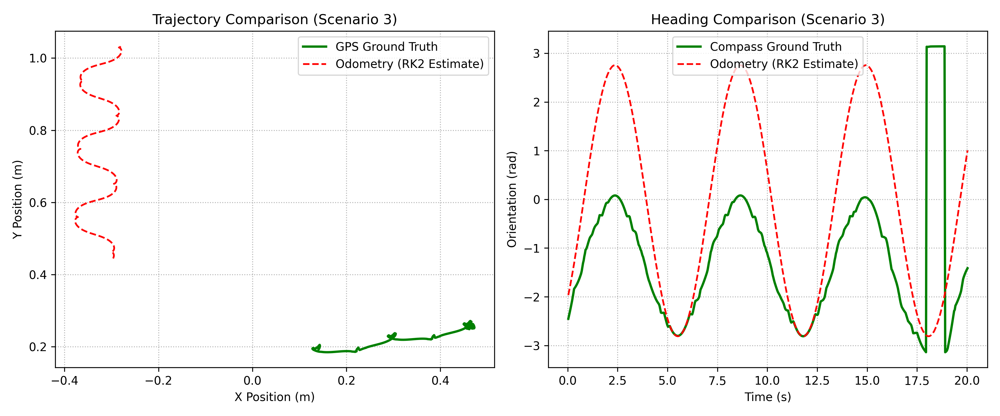

# Exercise 2: Robot Localization & Dead Reckoning

This module implements and analyzes **Odometry (Dead Reckoning)** on a differential drive robot (e-puck) and compares its drift errors against absolute ground truth measurements provided by simulated **GPS** and **Compass** sensors.

---

## Kinematics Theory

For an e-puck differential drive robot with wheel radius $R$ and wheelbase distance $L$, the linear velocities of the left and right wheels are given by their rotational encoder changes:

$$\Delta s_L = \Delta \phi_L \cdot R$$
$$\Delta s_R = \Delta \phi_R \cdot R$$

At each timestep, we calculate the robot's net forward displacement ($\Delta s$) and change in orientation ($\Delta \theta$):

$$\Delta s = \frac{\Delta s_R + \Delta s_L}{2}$$
$$\Delta \theta = \frac{\Delta s_R - \Delta s_L}{L}$$

### Runge-Kutta 2nd Order (Midpoint) Integration
To translate this relative movement into global coordinates $(x, y, \theta)$, we use a midpoint integration approximation rather than standard Euler integration. This reduces the cumulative error over curved paths:

$$x_{k+1} = x_k + \Delta s \cos\left(\theta_k + \frac{\Delta \theta}{2}\right)$$
$$y_{k+1} = y_k + \Delta s \sin\left(\theta_k + \frac{\Delta \theta}{2}\right)$$
$$\theta_{k+1} = \theta_k + \Delta \theta$$

---

## Evaluated Scenarios

The localization methods are compared across three distinct motion profiles:

1. **Scenario 1 (Unidirectional Arc):** Constant asymmetric wheel velocities ($\dot{\phi}_L = 2\,\text{rad/s}$, $\dot{\phi}_R = 1\,\text{rad/s}$) leading to a continuous circular arc trajectory.
2. **Scenario 2 (In-Place Spin):** Constant symmetric opposite velocities ($\dot{\phi}_L = -\pi\,\text{rad/s}$, $\dot{\phi}_R = \pi\,\text{rad/s}$), rotating about the geometric center.
3. **Scenario 3 (Harmonic Spiral):** Time-varying harmonic inputs ($\dot{\phi}_L = -5\cos(t)$, $\dot{\phi}_R = 5\sin(t)$) generating highly dynamic Lissajous-like patterns.

---

## Results & Analysis

| Scenario | Trajectory File | Core Observation |
|---|---|---|
| **Scenario 1** | `scenario1_results.png` | Smooth constant arc. Integration errors are minimal over short durations but slowly accumulate. |
| **Scenario 2** | `scenario2_results.png` | In-place rotation. Linear drift remains near zero; angular estimate tracks ground truth cleanly. |
| **Scenario 3** | `scenario3_results.png` | High-frequency acceleration changes. Exposes the minor integration lag of the digital encoders compared to real-time GPS. |

### Comparative Plots
*(Below are the generated comparisons of the trajectories and orientations)*

* **Scenario 1 Trajectory & Orientation:**
  
* **Scenario 2 Trajectory & Orientation:**
  
* **Scenario 3 Trajectory & Orientation:**
  