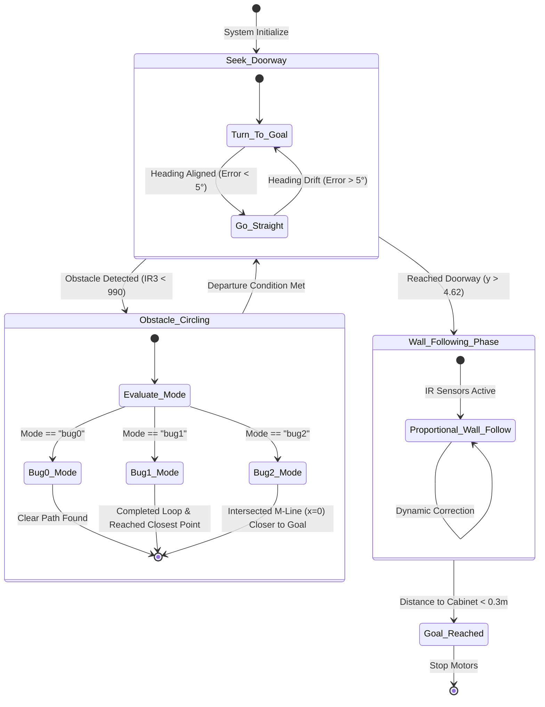

# Reactive Path Planning: Bug Algorithms & Wall-Following

This project implements and evaluates classic reactive obstacle avoidance algorithms on a differential-drive `e-puck` robot in a simulated Webots indoor environment.

## Project Overview
The mission is split into two sequential phases:
1. **Phase 1 (Doorway Navigation):** Navigate from an initial starting position of $(0.0, -2.7)$ to a transitional doorway goal at $(0.0, 4.7)$ utilizing Bug 0, Bug 1, or Bug 2.
2. **Phase 2 (Wall-Following):** Upon passing through the doorway, immediately transition to right-hand wall-following to autonomously traverse the corridor and reach a final cabinet goal at $(-3.2, 4.1)$.

---

## Performance Benchmarks

Below is the empirical data collected directly from our simulation runs:

| Navigation Strategy | Path Length (m) | Max Deviation from M-Line (m) | Key Characteristic |
| :--- | :---: | :---: | :--- |
| **Bug 0** | **12.52 m** | 3.85 m | Greedy and highly efficient, but prone to infinite trapping in non-convex obstacles. |
| **Bug 1** | **22.58 m** | 3.85 m | Exhaustive search. Fully circumnavigates each obstacle to find the optimal departure point. Guaranteed to find a path, but highly inefficient. |
| **Bug 2** | **12.87 m** | 3.85 m | Opportunistic. Constrains departure points to intersections with the original start-to-goal line ($M$-line). Excellent balance of efficiency and completeness. |

### Why is the Maximum Deviation identical across all runs?
Since the start and goal positions lie along the $y$-axis line ($x = 0$), the lateral deviation is a measure of how far left or right the robot is forced to wander. The value of **3.85 meters** represents the physical outer boundary of the widest obstacle block in the environment, which all three algorithms are physically forced to circumnavigate.

---

## Implementation Details
The controller uses an elegant, modular state-machine design implemented in Python:
* **Closed-loop Proportional Steering:** Yaw alignment is controlled dynamically by calculating heading errors via onboard `GPS` and `Compass` feedback.
* **Proportional Wall-Following:** Right-hand boundary tracking utilizes proportional adjustments of motor velocities based on IR distance readings to slide smoothly around obstacles.
* **Metric Extraction:** Computes cumulative Euclidean distance and perpendicular path-to-line deviation at runtime, exporting trajectories to CSV files for visualization.

## Finite State Machine (FSM) Architecture

The controller governs the robot's behaviors using a deterministic Finite State Machine (FSM). Below is the system's state transition diagram:

